# BTVN5 — Tối ưu trang quản lý 10.000 sản phẩm React

Mọi số liệu lấy từ [lighthouse/results.md](./lighthouse/results.md) (script sinh, `npm run results` = VALID, không STALE). Cách chạy: [README](./README.md).

## 1. Trang và phương pháp

- Trang quản lý sản phẩm: tìm kiếm có/không dấu, lọc 8 danh mục, sắp xếp tên/giá, sửa, xoá, thống kê. Dữ liệu sinh theo seed 42 (không gọi API), checksum 10.000 dòng `ee0af36b` giống nhau ở hai trang.
- [before.html](./before.html): viết ngây thơ, không làm chậm giả. [after.html](./after.html): virtualization + memoization + code-splitting.
- Lighthouse 13.5 Mobile (412×823, Slow 4G, CPU ×4), chỉ đo bản build, 5 lần mỗi trang, chọn run đại diện bằng `computeMedianRun`. Chrome 154.0.8037.93, Node 24.14.0 (bản cài sẵn, không đổi Node mặc định).

| Mục | Before | After |
| --- | --- | --- |
| Lighthouse | 13.5.0 | 13.5.0 |
| Chrome | 154.0.0.0 | 154.0.0.0 |
| Node | v24.14.0 | v24.14.0 |
| benchmarkIndex | 1857 | 1859 |
| Throttling | simulate (RTT 150 ms, 1638.4 Kbps, CPU x4) | simulate (RTT 150 ms, 1638.4 Kbps, CPU x4) |
| Số run hợp lệ / đã chạy | 5/5 | 5/5 |
| n / checksum dữ liệu | 10000 / `ee0af36b` | 10000 / `ee0af36b` |

## 2. Kết quả TRƯỚC và vấn đề

Before: **60 điểm**, FCP 1.805 ms, LCP 2.943 ms, TBT 5.726 ms, CLS 0, **100.049 phần tử DOM**, 132 KiB JS không dùng.

| 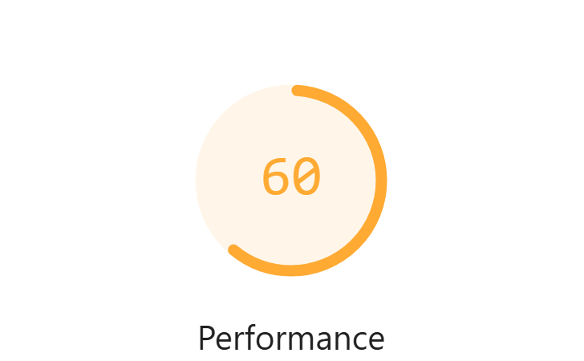 | 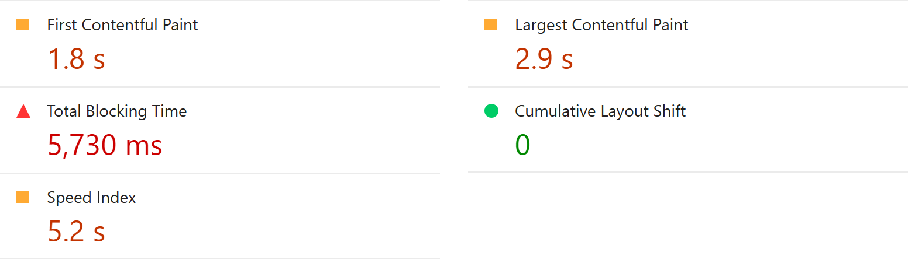 |
| --- | --- |
| *Điểm Lighthouse before* | *FCP, LCP, TBT, CLS before* |
| 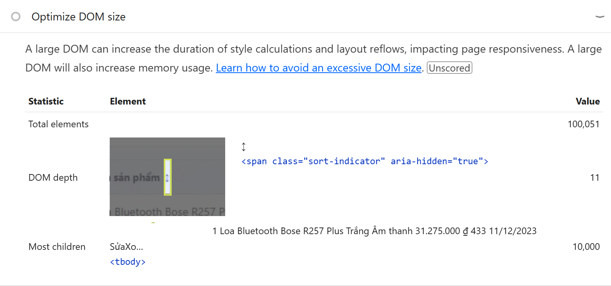 | 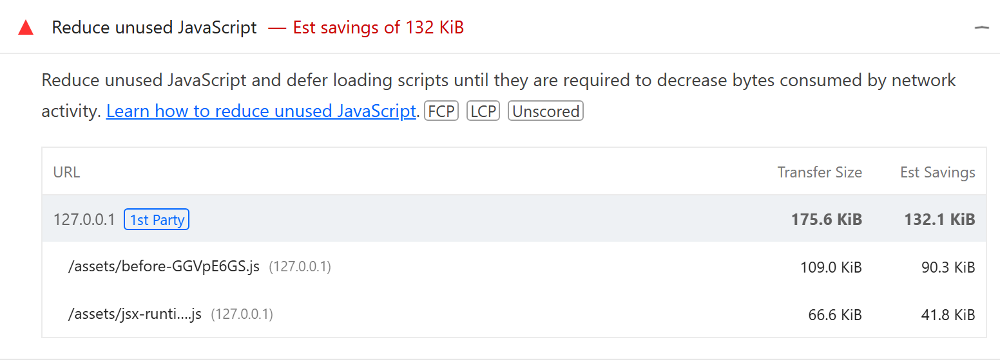 |
| *DOM before* | *JS không dùng before (Recharts nạp sớm)* |

| Vấn đề | Đoạn code gây ra (`src/before`) | Bằng chứng |
| --- | --- | --- |
| Render cả 10.000 dòng | `products.map(p => <ProductRow … />)` | DOM 100.049, TBT 5,7 s |
| Tính lại khi state không liên quan đổi | `useState(generateProducts(n))`, `filterAndSortProducts(...)` ngay trong thân component, `ProductRow` không `memo`, handler inline | Profiler: mở/huỷ form chạy lại `generate` và `filterSort`; sửa 1 dòng render lại 10.000 dòng |
| Tải Recharts và form dù chưa dùng | `import StatsChart`, `import EditProductForm` tĩnh | `chunks.json`: Recharts nằm trong JS ban đầu |

## 3. Giải pháp

| Kỹ thuật | Code (`src/after`) | Chỉ số cải thiện |
| --- | --- | --- |
| **Virtualization** | `useVirtualizer({ estimateSize: () => 44, overscan: 10 })`, bảng ARIA `table/row/cell` | DOM 100.049 → 267 |
| **Memoization** | `useState(() => generateProducts(n))`, `useMemo` cho `applied`/`visible`, `memo(ProductRow)`, `useCallback`, `useDeferredValue(search)` | Sửa 1 dòng: 10.000 → 1 lần render; mở/huỷ form: `generate`, `filterSort` 2 → 0 |
| **Code-splitting** | `import()` cho `StatsChart` và `EditProductForm`, `useRetryableLazy` + `LazyErrorBoundary` (Thử lại / Tải lại trang) | JS ban đầu gzip 175,5 → 80,4 KiB; JS không dùng −73% |

## 4. Kết quả SAU (before | after)

| Chỉ số | Before | After | Chênh lệch | % |
| --- | --- | --- | --- | --- |
| Performance score | 60 (57 - 60) | 97 (95 - 97) | +37 | +61.7% |
| FCP | 1,805 ms (1,805 ms - 1,811 ms) | 1,511 ms (1,511 ms - 1,553 ms) | -293 ms | -16.3% |
| LCP | 2,943 ms (2,869 ms - 3,350 ms) | 1,639 ms (1,639 ms - 1,685 ms) | -1,304 ms | -44.3% |
| TBT | 5,726 ms (4,741 ms - 6,165 ms) | 183 ms (183 ms - 222 ms) | -5,543 ms | -96.8% |
| CLS | 0.000 (0.000 - 0.000) | 0.000 (0.000 - 0.000) | 0.000 | — |
| Speed Index | 5,164 ms (5,036 ms - 5,454 ms) | 1,511 ms (1,511 ms - 1,553 ms) | -3,653 ms | -70.7% |
| Số phần tử DOM (tự đếm, `document.body`) | 100,049 | 267 | -99,782 | -99.7% |
| Số phần tử DOM (Lighthouse `dom-size-insight`) | 100,051 | 269 | -99,782 | -99.7% |
| JS không dùng (`unused-javascript`) | 132.1 KiB | 35.4 KiB | -96.8 KiB | -73.2% |
| Tổng byte tải (`total-byte-weight`) | 180.2 KiB | 85.7 KiB | -94.5 KiB | -52.4% |
| JS ban đầu (gzip) | 175.5 KiB | 80.4 KiB | -95.2 KiB | -54.2% |
| JS ban đầu (chưa nén) | 592.9 KiB | 254.0 KiB | -338.9 KiB | -57.2% |

| 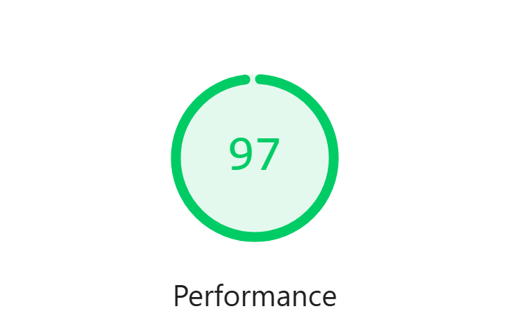 | 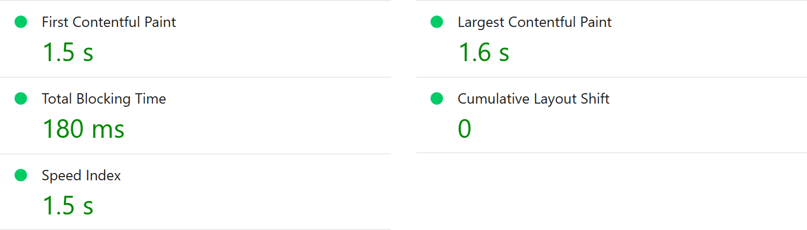 |
| --- | --- |
| *Điểm Lighthouse after (97)* | *FCP, LCP, TBT, CLS after* |
| 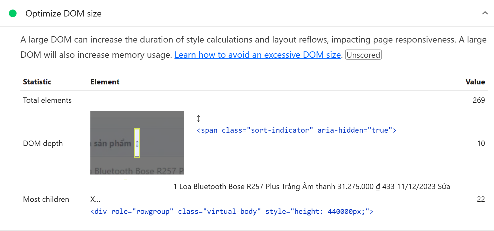 | 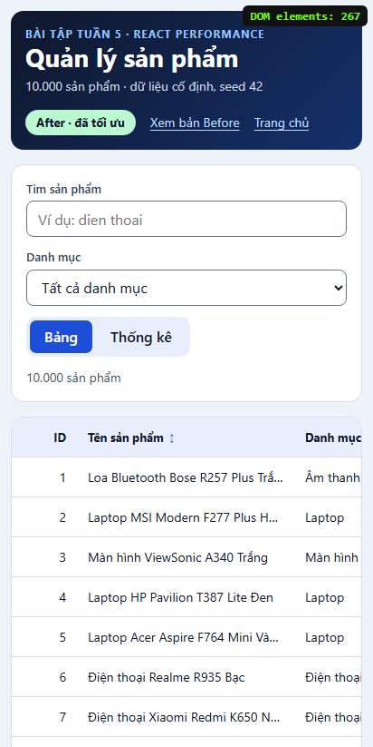 |
| *DOM after* | *Giao diện after, 412px* |

## 5. Bằng chứng bổ sung

**Quy mô `?n=` (3 lần mỗi ô, không ô nào lỗi):**

| n | Trang | Hợp lệ/đã chạy | Trạng thái | Score | FCP | LCP | TBT | DOM | Mã lỗi |
| --- | --- | --- | --- | --- | --- | --- | --- | --- | --- |
| 1,000 | before | 3/3 | ok | 98 | 1,969 ms | 1,969 ms | 61 ms | 10,049 | - |
| 1,000 | after | 3/3 | ok | 99 | 1,510 ms | 1,587 ms | 104 ms | 267 | - |
| 10,000 | before | 3/3 | ok | 57 | 1,972 ms | 3,219 ms | 6,016 ms | 100,049 | - |
| 10,000 | after | 3/3 | ok | 96 | 1,509 ms | 1,644 ms | 219 ms | 267 | - |
| 50,000 | before | 3/3 | ok | 36 | 1,971 ms | 6,293 ms | 18,753 ms | 500,049 | - |
| 50,000 | after | 3/3 | ok | 80 | 1,513 ms | 1,931 ms | 785 ms | 267 | - |

**Timespan** (gõ "dien thoai" rồi sắp xếp giá; TBT Timespan không so được với TBT navigation):

| Chỉ số | Before | After | Chênh lệch | % |
| --- | --- | --- | --- | --- |
| TBT (Timespan) | 12,102 ms (numeric) | 663 ms (numeric) | -11,439 ms | -94.5% |
| CLS (Timespan) | 0.000 (numeric) | 0.000 (numeric) | 0.000 | — |
| INP | 3,855 ms (numeric) | 201 ms (numeric) | -3,654 ms | -94.8% |

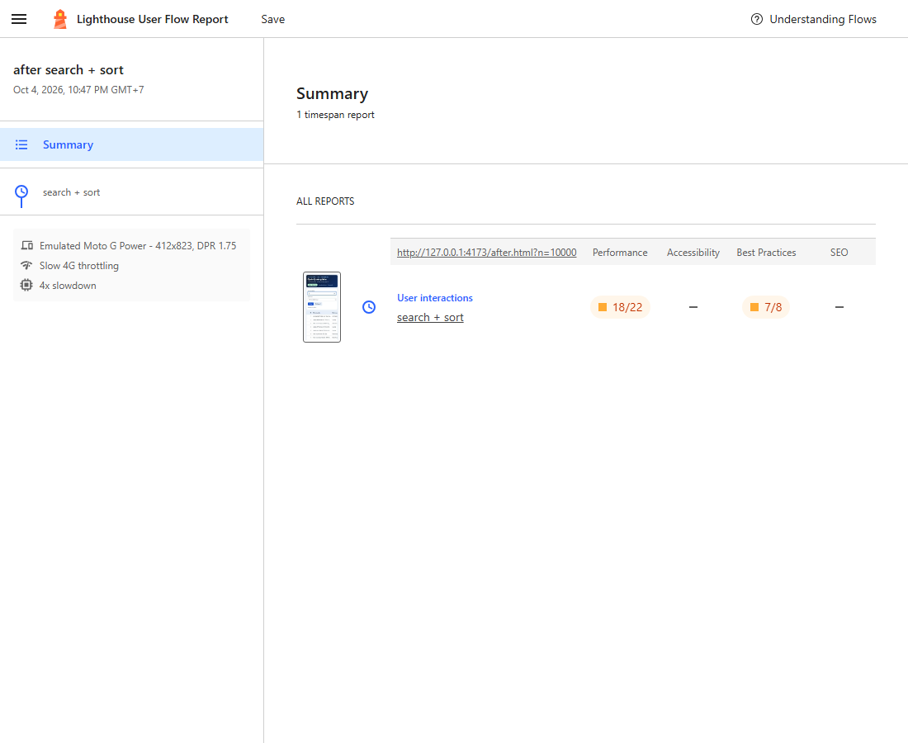

*User Flow after.*

**Profiler** (build profiling; (c) là bằng chứng tổng hợp của cả ba kỹ thuật, không riêng memo):

| Số đo | Before | After | Chênh lệch | % |
| --- | --- | --- | --- | --- |
| (a) số dòng đang render trong DOM | 10,000 | 22 | - | - |
| (a) `rowRender` sau khi sửa 1 sản phẩm | 10,000 | 1 | -9,999 | -100.0% |
| (b) `generate` khi mở/huỷ form | 2 | 0 | -2 | -100.0% |
| (b) `filterSort` khi mở/huỷ form | 2 | 0 | -2 | -100.0% |
| (c) `App` commits | 11 | 22 | +11 | +100.0% |
| (c) `App` actualDuration tổng | 568.6 ms | 206.7 ms | -361.9 ms | -63.6% |
| (c) `App` actualDuration lớn nhất | 151.6 ms | 22.8 ms | -128.8 ms | -85.0% |

**Accessibility** (so cùng n=1.000; before ở n=10.000 bị `PROTOCOL_TIMEOUT`, giữ trong `a11y-n10000.json`; không đổi cấu hình Lighthouse):

| Mục | Before | After |
| --- | --- | --- |
| n (cùng quy mô so sánh) | 1000 | 1000 |
| Điểm | 100 | 100 |
| Audit chưa đạt | không | không |

**Chunk:** [before](./lighthouse/before/chunks.json) có Recharts trong JS ban đầu; [after](./lighthouse/after/chunks.json) chỉ có trong chunk lazy.

**Tương đương chức năng** ([parity.json](./lighthouse/parity.json), ảnh `parity-*`): cùng checksum, cùng kết quả tìm/lọc/sắp xếp/xoá/sửa, form chặn giá −1, 1e308, 1.5, tên rỗng, tồn kho 1001; `?n=0/abc/999999` đúng; 412px cuộn ngang không tràn.

| 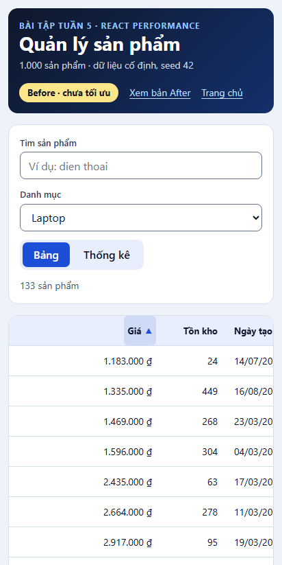 | 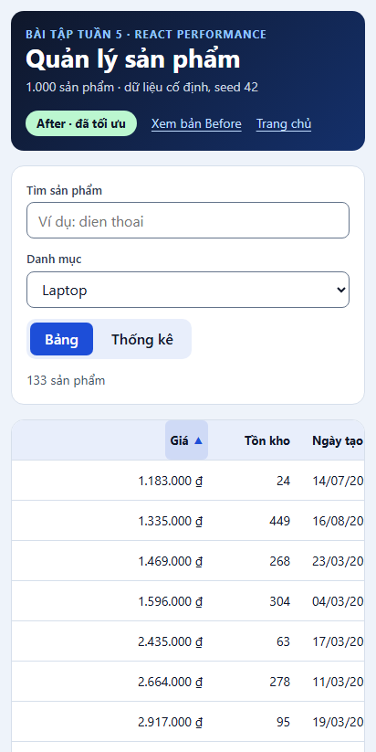 |
| --- | --- |
| *Before: giá tăng dần* | *After: cùng kết quả* |
| 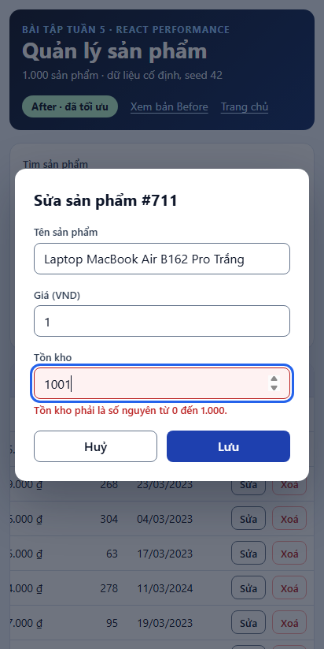 | 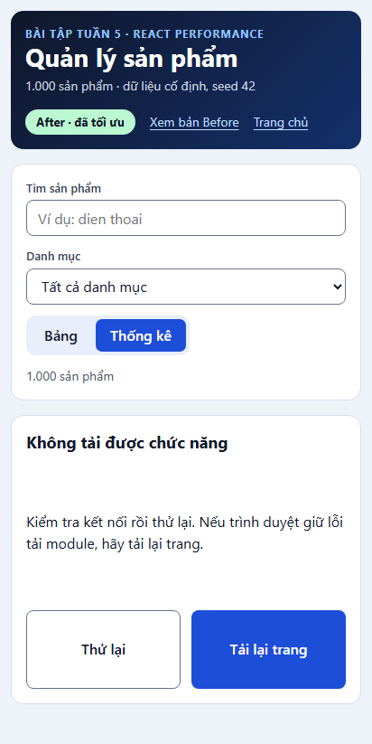 |
| *Form chặn tồn kho 1001* | *Chunk bị chặn: có fallback lỗi* |

## 6. Phương án không chọn

Phân trang (đổi trải nghiệm cuộn), `react-window` (cùng mục đích, chọn TanStack Virtual để tự kiểm soát ARIA), Web Worker (ngoài phạm vi, không giảm DOM).

## 7. Chỉ số không cải thiện và giới hạn

- n=1.000: TBT after 104 ms cao hơn before 61 ms (chi phí khởi tạo virtualizer [INFERENCE]); điểm vẫn 98–99.
- n=50.000: after TBT còn 785 ms; virtualization không giảm chi phí sinh/lọc toàn bộ mảng.
- Profiler (c): số commit 11 → 22 do `useDeferredValue`, dù tổng thời gian commit giảm 568,6 → 206,7 ms.
- CLS đều 0 nên không có cải thiện. INP after 201 ms, sát ngưỡng 200 ms.
- Nút "Thử lại" không phục hồi chunk lỗi cùng URL; phải "Tải lại trang" (đã thử bằng CDP).
- Lighthouse 13 bỏ audit `dom-size`: DOM là số tự đếm `document.body`.
- Accessibility chỉ so được ở n=1.000; chưa thử NVDA/JAWS. Trạng thái rỗng của after là text dưới `table`, chưa kiểm bằng trình đọc màn hình.
- Kết quả phụ thuộc máy đo (`benchmarkIndex` 1857/1859). Lint còn 1 cảnh báo `incompatible-library` (TanStack Virtual); React Compiler không bật.

## 8. Tính toàn vẹn

Baseline before được đo và lưu snapshot trước khi viết after; sau đó `src/before`, `src/shared`, `before.html`, `vite.config.ts`, `package-lock.json` không đổi.

| | Before | After |
| --- | --- | --- |
| `sourceHash` | `ff7ea850…eb696` | `2d9afa4b…112b2` |
| `buildHash` (navigation) | `285db257…547b3` (khớp `build-snapshot`) | `7296e4cb…83f10` |

Thêm entry after làm bundler chia lại chunk của before: scale và Accessibility của before chạy trên build chia lại (`buildHash` `91ef64c8…`, cùng `sourceHash`); `results.md` giữ cảnh báo này. `fetchTime` chỉ chứng minh thứ tự đo. Kiểm tra tương đương chạy bằng browser smoke trong phiên, không phải script tái sinh được.
