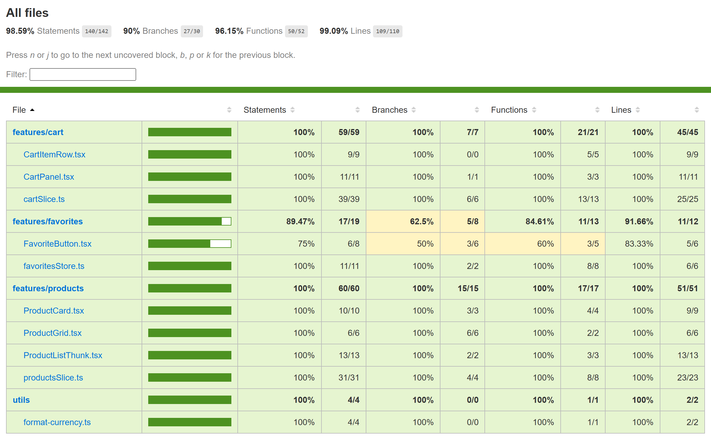

# BTVN6 - Kiểm thử module giỏ hàng/sản phẩm bằng Jest + React Testing Library

Ứng dụng là bản copy của `BaiTapTuan4` (Vite, React 19, Redux Toolkit, Zustand). Bài này chỉ thêm bộ test, không đổi hành vi của app.

## Lệnh chạy

```bash
npm install
npm test                # chạy toàn bộ test
npm run test:coverage   # chạy test kèm báo cáo coverage (jest --coverage)
npm run build           # tsc -b kiểm kiểu cả file test, rồi vite build
```

Báo cáo HTML được sinh ra ở `coverage/lcov-report/index.html` (thư mục này không commit).

## Các test case

Có 17 case theo đề, được hiện thực bằng 26 lệnh `it` (một số case được tách nhỏ, kèm vài case bổ sung cho nhánh phụ).

| # | Nội dung | Loại | File |
|---|---|---|---|
| 1 | `formatCurrency(19.99)` ra `$19.99`, `formatCurrency(0)` ra `$0.00` | Unit | `src/utils/format-currency.test.ts` |
| 2 | `selectCartTotalQuantity` cộng đúng số lượng | Unit | `src/features/cart/cartSlice.test.ts` |
| 3 | `selectCartTotalPrice` bằng tổng giá nhân số lượng | Unit | `src/features/cart/cartSlice.test.ts` |
| 4 | `addToCart` sản phẩm mới thì `quantity: 1` | Unit | `src/features/cart/cartSlice.test.ts` |
| 5 | `addToCart` sản phẩm đã có thì tăng `quantity`, độ dài giữ nguyên | Unit | `src/features/cart/cartSlice.test.ts` |
| 6 | `removeFromCart` chỉ xoá đúng `id` | Unit | `src/features/cart/cartSlice.test.ts` |
| 7 | `updateQuantity` số dương thì cập nhật số lượng | Unit | `src/features/cart/cartSlice.test.ts` |
| 8 | `updateQuantity` số ≤ 0 thì xoá sản phẩm | Unit | `src/features/cart/cartSlice.test.ts` |
| 9 | `clearCart` làm giỏ rỗng | Unit | `src/features/cart/cartSlice.test.ts` |
| 10 | `fetchProducts` thành công: `status: 'succeeded'`, `items` đúng, `fetch` gọi với URL chứa `PRODUCTS_QUERY` | Async (mock `fetch`) | `src/features/products/productsSlice.test.ts` |
| 11 | `fetchProducts` khi HTTP 500: `status: 'failed'`, lỗi `Máy chủ trả về mã lỗi 500` | Async (mock `fetch`) | `src/features/products/productsSlice.test.ts` |
| 12 | `fetchProducts` khi `fetch` reject: lỗi `Không kết nối được tới máy chủ sản phẩm`; `pending` thì `status: 'loading'` | Async (mock `fetch`) | `src/features/products/productsSlice.test.ts` |
| 13 | `useFavoritesStore`: `toggleFavorite` thêm/bỏ, `removeFavorite` xoá (dùng `renderHook`) | Unit (hook) | `src/features/favorites/favoritesStore.test.ts` |
| 14 | `CartPanel` rỗng hiện `Giỏ hàng đang trống.` | Integration (RTL) | `src/features/cart/CartPanel.test.tsx` |
| 15 | `ProductCard` và `CartPanel` dùng chung store: bấm `Thêm vào giỏ` 2 lần thì badge `2`, `2 sản phẩm`, tổng tiền đúng | Integration (RTL) | `src/features/cart/CartPanel.test.tsx` |
| 16 | Tăng/giảm, xoá từng sản phẩm, xoá toàn bộ giỏ với `preloadedState`, UI cập nhật theo | Integration (RTL) | `src/features/cart/CartPanel.test.tsx` |
| 17 | `ProductListThunk`: (a) đang tải rồi hiện sản phẩm; (b) lỗi thì `Thử lại`, `fetch` gọi 2 lần rồi hiện sản phẩm | Integration + Async (mock `fetch`) | `src/features/products/ProductListThunk.test.tsx` |

Các case bổ sung: `updateQuantity` với `id` không tồn tại, thông điệp lỗi mặc định khi `rejected` không có payload, giảm số lượng về 0, gõ số lượng vào ô input, xoá trắng ô input, và danh sách sản phẩm rỗng.

Không gọi mạng thật: `src/test/setup-tests.ts` gán sẵn một `fetch` luôn reject, nên test nào quên mock sẽ lỗi ngay thay vì gọi ra ngoài. Các test bất đồng bộ gán `globalThis.fetch` bằng `jest.fn()` và khôi phục sau mỗi test.

## Phạm vi coverage

Được tính (`collectCoverageFrom` trong `jest.config.js`):

- `src/features/cart/**`
- `src/features/products/{productsSlice.ts, ProductListThunk.tsx, ProductGrid.tsx, ProductCard.tsx}`
- `src/features/favorites/{favoritesStore.ts, FavoriteButton.tsx}`
- `src/utils/**`

Không tính:

- `*.types.ts`: chỉ có kiểu, không có mã chạy.
- `productsApi.ts`, `ProductListQuery.tsx`: nhánh RTK Query nằm ngoài phạm vi bài.
- `FavoritesPanel.tsx`, `FavoriteItemRow.tsx`: giao diện danh sách yêu thích, không thuộc module giỏ hàng/sản phẩm.
- `main.tsx`, `App.tsx`: điểm khởi động và phần ghép giao diện.

`coverageThreshold` đặt 70% cho cả bốn chỉ số, nên `npm run test:coverage` sẽ lỗi nếu có chỉ số dưới ngưỡng.

## Kết quả coverage

Lấy từ lần chạy `npm run test:coverage` (đầy đủ trong `bao-cao/coverage-terminal.txt`): 6 suite, 26 test, tất cả đều pass.

| Statements | Branches | Functions | Lines |
|---|---|---|---|
| 98.59% | 90% | 96.15% | 99.09% |

Phần chưa phủ: `FavoriteButton.tsx` dòng 22 (xử lý bấm nút yêu thích, được kiểm tra qua `favoritesStore` ở case 13 nhưng chưa bấm qua giao diện).

Ảnh báo cáo `bao-cao/coverage-report.png` chụp từ `coverage/lcov-report/index.html`, có mở rộng từng thư mục để thấy số liệu của từng file.



Ảnh terminal `bao-cao/test-terminal.png` dựng lại từ output có màu (mã ANSI) của lệnh `npm run test:coverage -- --verbose`. Ảnh liệt kê từng test đã pass, gồm 6 test bất đồng bộ dùng API mock trong hai nhóm `fetchProducts (API mock)` và `ProductListThunk (API mock)`.


