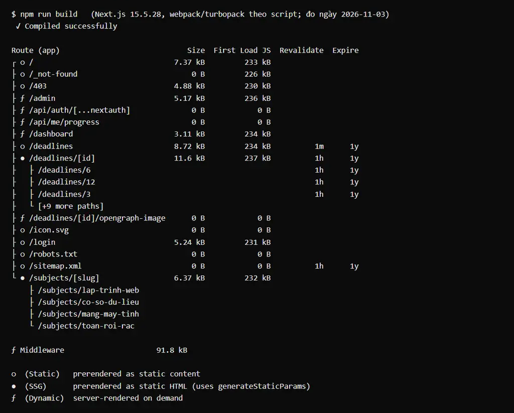
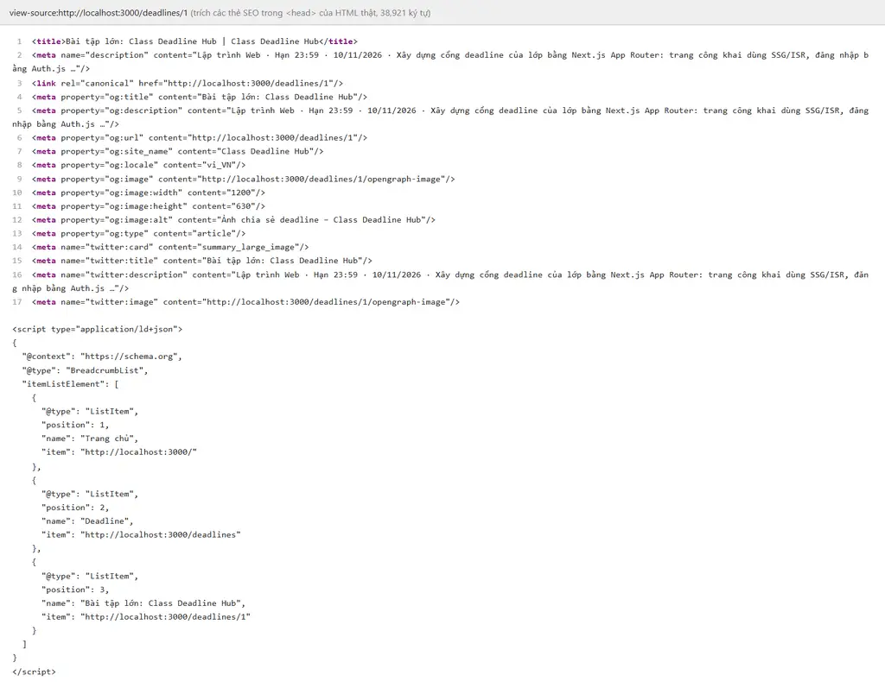

# Class Deadline Hub

Bài thực hành BTTH3, môn Lập trình Web nâng cao (PTIT).

Thưa thầy, đây là cổng theo dõi deadline của lớp. Ai cũng xem được lịch chung, sinh viên đăng nhập để đánh dấu bài đã xong, còn lớp trưởng (admin) được thêm và xoá deadline. Dữ liệu lưu bằng file JSON phía server (4 môn, 12 deadline), không dùng database.

- **Bản chạy thật:** https://deadline.anhpddev.com
- **Công nghệ:** Next.js 15.5 (App Router, React 19, TypeScript), Auth.js v5 (Credentials + GitHub OAuth, session JWT), Tailwind CSS v4, zod, Jest.

## Cách chạy

Cần Node.js 20 trở lên.

```bash
npm install
cp .env.example .env.local      # Windows PowerShell: Copy-Item .env.example .env.local
```

Trong `.env.local`, em điền `AUTH_SECRET` bằng một chuỗi ngẫu nhiên, ví dụ sinh bằng:

```bash
node -e "console.log(require('crypto').randomBytes(32).toString('base64'))"
```

`AUTH_GITHUB_ID` và `AUTH_GITHUB_SECRET` là tuỳ chọn: để trống thì trang đăng nhập chỉ có email/mật khẩu.

```bash
npm run dev                  # chạy thử: http://localhost:3000
npm run build && npm start   # bản production
npm test                     # Jest
```

Tài khoản thử (email và mật khẩu theo đề, mật khẩu lưu dạng hash bcrypt):

| Email | Mật khẩu | Vai trò |
|---|---|---|
| `admin@ptit.edu.vn` | `admin123` | Lớp trưởng (`admin`) |
| `sv@ptit.edu.vn` | `sv123456` | Sinh viên (`user`) |

## Chiến lược render và lý do em chọn

| Route | Chiến lược | Vì sao em chọn |
|---|---|---|
| `/` | SSG | Trang chủ ai vào cũng thấy giống nhau và ít khi đổi, nên em dựng sẵn HTML lúc build để trang mở nhanh nhất. Khi admin thêm/xoá, Server Action gọi `revalidatePath('/')` để trang cập nhật. |
| `/subjects/[slug]` | SSG | Chỉ có 4 môn cố định nên em dựng sẵn cả 4 trang bằng `generateStaticParams`. Môn nào có thay đổi thì làm mới đúng trang môn đó. |
| `/deadlines` | ISR 60 giây | Danh sách chung chấp nhận trễ tối đa 1 phút, nên em để `revalidate = 60` cho đúng đề và cố ý không làm mới theo thao tác của admin, để thấy rõ khác biệt với trang chi tiết. |
| `/deadlines/[id]` | ISR on-demand | Trang chi tiết cần đúng ngay khi admin thêm/xoá. Em vẫn phục vụ HTML tĩnh, nhưng Server Action gọi `revalidatePath` để làm mới ngay lập tức (xem câu hỏi 1). |
| `/dashboard` | SSR | Mỗi sinh viên có bảng việc riêng, nên trang phải dựng theo từng người ở mỗi request. |
| `/admin` | SSR | Cần dữ liệu mới nhất và phải kiểm tra quyền ở mỗi request. |

Kết quả `npm run build` (bản văn bản: [docs/build-output.txt](docs/build-output.txt)). Ký hiệu: `○` tĩnh, `●` dựng sẵn qua `generateStaticParams`, `ƒ` dựng theo request; cột Revalidate cho thấy `1m` ở `/deadlines` và `1h` (lưới an toàn) ở `/deadlines/[id]`.



## Ảnh view-source `/deadlines/1`

Trong ảnh thấy được `<title>`, `og:image` (ảnh chia sẻ riêng của từng deadline), `canonical` và JSON-LD `BreadcrumbList`:



## Em đã làm các yêu cầu như thế nào

**Routing và component.** Em chia 2 route group: `(public)` cho trang công khai và `(app)` cho phần cần đăng nhập, mỗi nhóm một layout riêng. `/dashboard` có layout lồng với sidebar, menu tô sáng trang đang mở. Có `loading.tsx` (skeleton), `error.tsx` (nút "Thử lại") và `not-found.tsx`; id hoặc slug không tồn tại trả 404 thật. Mặc định em dùng Server Component; chỉ các phần cần tương tác mới có `'use client'`, như đồng hồ đếm ngược ("Còn X ngày / Quá hạn Y ngày"), bộ lọc, form, nút đăng xuất.

**Xác thực.** Em dùng Auth.js với Credentials, session kiểu JWT. `id` và `role` có trong session, khai báo kiểu ở `types/next-auth.d.ts` với `role: 'admin' | 'user'` chứ không dùng `string`. Header hiện tên, vai trò và nút Đăng nhập/Đăng xuất.

**Phân quyền.** Toàn bộ ma trận quyền nằm ở một chỗ là `lib/permissions.ts`, mọi nơi đều hỏi qua `can(role, action)`:

| Hành động | guest | user | admin |
|---|:---:|:---:|:---:|
| Xem deadline | ✓ | ✓ | ✓ |
| Đánh dấu đã xong | ✗ | ✓ | ✓ |
| Thêm deadline | ✗ | ✗ | ✓ |
| Xoá deadline | ✗ | ✗ | ✓ |

Em kiểm tra quyền ở 3 lớp. `middleware.ts` chặn `/dashboard` và `/admin`: chưa đăng nhập thì chuyển về `/login?callbackUrl=…`, sinh viên vào `/admin` thì chuyển `/403`. Trang `/admin` tự gọi `requirePermission()` thêm một lần. Mỗi Server Action tự kiểm tra theo thứ tự: đăng nhập → `can()` → validate bằng zod → ghi file → `revalidatePath`. `userId` luôn lấy từ session, không lấy từ dữ liệu client gửi lên.

**SEO.** `/deadlines/[id]` có metadata động và ảnh chia sẻ riêng cho từng deadline (`ImageResponse`, có font tiếng Việt). Sitemap có đủ mọi deadline; robots chặn `/dashboard` và `/admin`; `/login` và `/dashboard` gắn `noindex`. Trang chi tiết có JSON-LD `BreadcrumbList`. Font dùng `next/font` với subset `vietnamese`, ảnh xem trước chia sẻ dùng `next/image`.

## Điểm Lighthouse

Em đo bằng Lighthouse CLI trên bản production (`npm run build && npm start`), chế độ mobile mặc định (giả lập 4G chậm, CPU chậm 4 lần), ngày 2026-11-03. Báo cáo gốc nằm ở `lighthouse/home.report.html` và `lighthouse/deadline-1.report.html`.

| Trang | Performance | Accessibility | Best Practices | SEO |
|---|---|---|---|---|
| `/` | 79 | 100 | 100 | 100 |
| `/deadlines/1` | 79 | 100 | 100 | 100 |

Performance chưa tới 90 vì LCP khoảng 5 giây trong điều kiện giả lập chậm, phần lớn là thời gian chờ tải font. Em đã thử bớt font nhưng điểm chưa đổi, nên em ghi lại đúng số đo.

## Trả lời câu hỏi

### (1) Vì sao `/deadlines/[id]` dùng ISR?

Vì trang này vừa cần nhanh, vừa cần đúng ngay.

- Đây là trang công khai, hay được chia sẻ link, nên em muốn có HTML dựng sẵn: Google đọc được, ảnh xem trước hiện đúng, và server không phải đọc file JSON ở mỗi lượt truy cập.
- Nhưng nội dung lại đổi khi admin thêm hoặc xoá. Nếu dùng SSG thuần thì phải build lại cả trang web; nếu dùng SSR thì mỗi request đều phải dựng lại dù dữ liệu không đổi.
- ISR on-demand giải quyết được cả hai: bình thường phục vụ trang tĩnh từ cache, còn khi admin thao tác thì Server Action gọi `revalidatePath` để làm mới đúng trang đó. `dynamicParams = true` giúp deadline mới thêm sau khi build vẫn xem được ngay.

Em đã thử trên bản thật: thêm deadline thì `/deadlines/13` xem được ngay, xoá xong thì lần tải đầu tiên đã trả 404. Trong lúc làm em gặp một lỗi: `revalidatePath` khi truyền kiểu `'page'` phải ghi đủ route group (`/(public)/deadlines/[id]`), em viết thiếu nên ban đầu trang xoá rồi vẫn hiện bài cũ. Em đã sửa và đo lại.

### (2) Nếu chỉ dùng Middleware để bảo vệ `/admin` thì có rủi ro gì?

- Server Action thực chất là một endpoint POST, gọi được từ bất kỳ trang nào bằng header `Next-Action`, không đi qua đường `/admin`. Nên chặn `/admin` bằng middleware không ngăn được ai đó gọi thẳng action xoá deadline.
- Matcher của middleware có thể viết sai hoặc quên cập nhật khi đổi tên route.
- Next.js từng có lỗ hổng cho phép bỏ qua middleware (CVE-2025-29927, header `x-middleware-subrequest`). Nếu middleware là lớp duy nhất thì khu quản trị sẽ bị lộ hoàn toàn.
- Middleware chạy ở Edge, chỉ đọc JWT, không kiểm tra lại quyền tại đúng lúc ghi dữ liệu.

Vì vậy em kiểm tra thêm ở trang và ở từng Server Action bằng cùng hàm `can()`. Em đã thử gửi lại request xoá bằng cookie của khách và của sinh viên: server từ chối và file dữ liệu không đổi.

## Điểm cộng

- **Test Jest:** 4 bộ, 52 test, đều pass. Gồm ma trận `can()` cho từng cặp vai trò và hành động, các hàm tính thời gian, chống chuyển hướng độc hại qua `callbackUrl`, và ghép tài khoản GitHub theo email.
- **Đăng nhập GitHub (OAuth):** email GitHub (đã xác minh) trùng tài khoản có sẵn thì dùng luôn tài khoản đó; không trùng thì là sinh viên mới, không ai tự lên được quyền admin. Nút GitHub chỉ hiện khi server có đủ key.
- **Deploy:** em deploy lên Hostinger thay vì Vercel, vì app ghi dữ liệu vào file JSON mà Vercel chỉ cho đọc file (lỗi `EROFS`). Hostinger chạy `next start` như một server Node thật nên ghi được file và ISR on-demand hoạt động. Dữ liệu thay đổi nằm ở thư mục `DATA_DIR` ngoài thư mục code, nên deploy lại không bị mất.

## Ghi chú

- Sau proxy của Hostinger, Next nhận địa chỉ `0.0.0.0:3000`, làm nút Đăng xuất bị chuyển sai trang. Em sửa bằng cách cho Auth.js lấy `AUTH_URL` theo `SITE_URL`.
- Với deadline có sẵn từ lúc build (id 1–12) rồi bị xoá, lần đo trước cho thấy trang hiện đúng nội dung "không tìm thấy" nhưng mã HTTP vẫn là 200. Em chưa đo lại sau khi sửa vì phải xoá dữ liệu thật.
- Bài không nộp kèm `node_modules`, `.next` và `.env.local` (đã có trong `.gitignore`).
